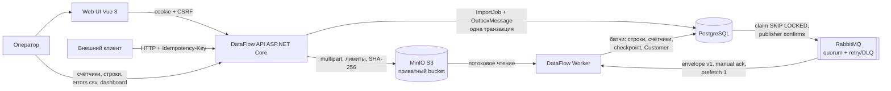

# Архитектура DataFlow (краткая публичная схема)

DataFlow — приём табличных файлов (CSV/XLSX) через HTTP, их надёжная фоновая
обработка в отдельном Worker и разбор результатов оператором. Модульный монолит:
два процесса (API и Worker) над общими библиотеками Domain/Application/Infrastructure,
одна база PostgreSQL, один брокер RabbitMQ и приватное S3-хранилище (локально MinIO).

## Компоненты

## Сценарий

1. Оператор создаёт источник со схемой (модель Customer или универсальные
   пользовательские правила Tabular). Схема версионируется; изменения не
   затрагивают снимок схемы уже созданных заданий.
2. Файл загружается на `POST /api/v1/data-sources/{id}/files` с обязательным
   `Idempotency-Key`: потоковая передача во временное хранилище, SHA-256,
   лимиты размера/формата; повтор запроса возвращает то же задание, конфликт
   ключа с другим содержимым — `409`.
3. `ImportJob` (статус `Queued`, снимок схемы) и сообщение outbox фиксируются
   в одной транзакции PostgreSQL. HTTP-ответ — `202 Accepted` + `Location`;
   файл в рамках запроса не обрабатывается.
4. Диспетчер outbox API пулингом захватывает сообщения (`FOR UPDATE SKIP LOCKED`,
   lease) и публикует их в RabbitMQ с publisher confirms; транзакция БД закрывается
   до сетевой публикации. Контекст трассировки сохраняется вместе с сообщением.
5. Worker получает сообщение (manual ack, prefetch 1), захватывает lease задания
   (heartbeat + fencing по времени БД) и потоково читает файл из S3: строки
   нормализуются и проверяются, обрабатываются батчами по `Import:BatchSize`
   (250–500) — результаты строк, счётчики, checkpoint и upsert `Customer`
   коммитятся одной транзакцией на батч.
6. По EOF фиксируются `TotalRows`, терминальный статус (`Completed`,
   `CompletedWithErrors`), inbox и итоговое outbox-сообщение; после commit — ack.
   `totalRows` остаётся `null` до EOF.

## Двухфазный Prepare / Commit

Для multi-part конфигурации API сначала сохраняет исходный объект и immutable
manifest (`PartIndex`, locators, raw headers и bounded preview), затем клиент явно
назначает правила частям и подтверждает их. `PreparedUpload` хранит token hash,
AES-256-GCM replay response и TTL; plaintext token отсутствует. Commit проверяет
HEAD + ContentLength + SHA-256 metadata (доступны native checksum и strict full
streaming), заголовки из manifest без GET и в одной транзакции создаёт один Job,
все Part, UploadRequest и outbox. Повторы используют независимые idempotency v3
keys без legacy alias reuse. Источник истины Worker при последующих этапах —
persisted Part/locator, а не перестроенный manifest. Подробности — ADR-003…005.

## Результаты и статусы

- Статусы задания: `Queued → Processing → Completed | CompletedWithErrors`,
  `RetryScheduled`, `Failed` (retryable/non-retryable), `Cancelled`;
  счётчик `ProcessedRows = Inserted + Updated + Invalid + Duplicate` (+ `Valid`
  для универсальных правил).
- Результат строки: `Inserted` (новый ключ), `Updated` (тот же натуральный ключ,
  другой `RowHash`), `Duplicate` (тот же ключ и тот же хеш), `Invalid`
  (ошибки валидации с полем, кодом и сообщением; повтор ключа внутри файла —
  `duplicate_key_in_file`).
- Ошибки строк доступны по `GET /import-jobs/{id}/rows` (пагинация, фильтр)
  и потоковым отчётом `GET /import-jobs/{id}/errors.csv` (RFC 4180 с защитой
  от spreadsheet formula injection). Сводные показатели — `GET /dashboard/summary`.

## Надёжность

| Угроза | Защита |
|---|---|
| Повторная доставка брокера / повтор HTTP | Transactional outbox + inbox (`ProcessedMessages`), идемпотентный upload по `Idempotency-Key`, уникальность ключа |
| Остановка Worker во время обработки | Lease с heartbeat и fencing-токеном; незавершённый батч откатывается, доставка остаётся unacked; возобновление с checkpoint и восстановлением множества ключей |
| Потеря сообщения между БД и брокером | Outbox публикуется только после фиксации транзакции; reconciliation подбирает просроченные задания и retries |
| Временные сбои | Ограниченные retry-очереди 5 с / 30 с / 5 мин; после 4 попыток задание `Failed` (retryable) и сообщение уходит в DLQ; ручной retry продолжает checkpoint |
| Большой файл | Потоковое чтение, лимиты строк/колонок/ячеек/размера, память ограничена батчем и множеством ключей файла |
| Ядовитое сообщение | Неисправимые ошибки файла/контракта не возвращаются в очередь; терминальный `Failed` без безграничных повторов |

## Наблюдаемость

Serilog JSON-логи с correlation id и scopes `JobId/MessageId/TraceId`;
OpenTelemetry (HTTP, Npgsql, messaging) с экспортом OTLP; метрики Prometheus:
длительность импорта, строки по исходам, retries, redeliveries, backlog outbox,
ошибки зависимостей. Liveness/readiness health checks не раскрывают секретов.

## Ограничения MVP

- Один источник данных на пользователя (владелец), без ролей и OIDC —
  cookie-сессии Identity.
- Форматы: CSV (UTF-8, фиксированный delimiter) и XLSX (первый лист); XML,
  REST-источники, SignalR, правка отдельных строк — после MVP.
- Атомарность — на уровне батча: при неисправимой ошибке файла ранее
  закоммиченные батчи сохраняются.
- Очередь retry/отмена — ручные операции через API; авто-retry ограничен
  4 попытками (5 с/30 с/5 мин).
- Ориентиры производительности (локальная машина, README): 1 000 строк
  за ≤ 30 секунд после захвата, RSS Worker ≤ 512 MB на fixture до 25 MB;
  фактические замеры — в [benchmarks/README.md](benchmarks/README.md).

## Демо

Публичные samples и ожидаемые результаты описаны в [samples/README.md](samples/README.md):
источник → загрузка с ошибками → отчёт CSV → исправленный файл → счётчики
insert/update/duplicate, восстановление после остановки Worker —
`tools/demo-recovery.mjs` против полного Compose.
